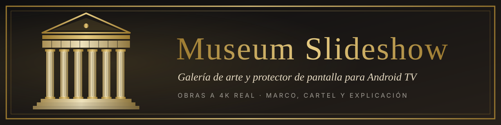
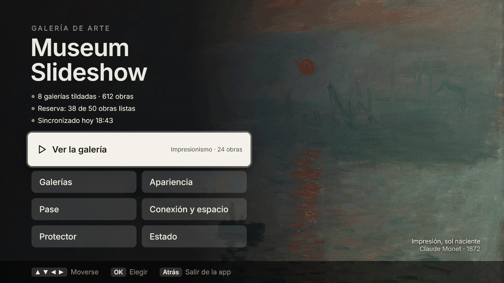
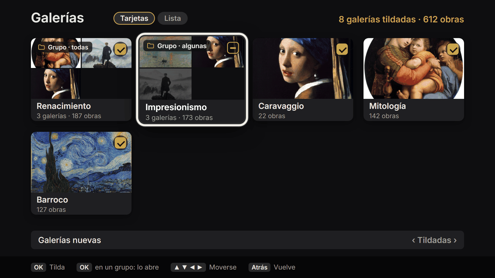
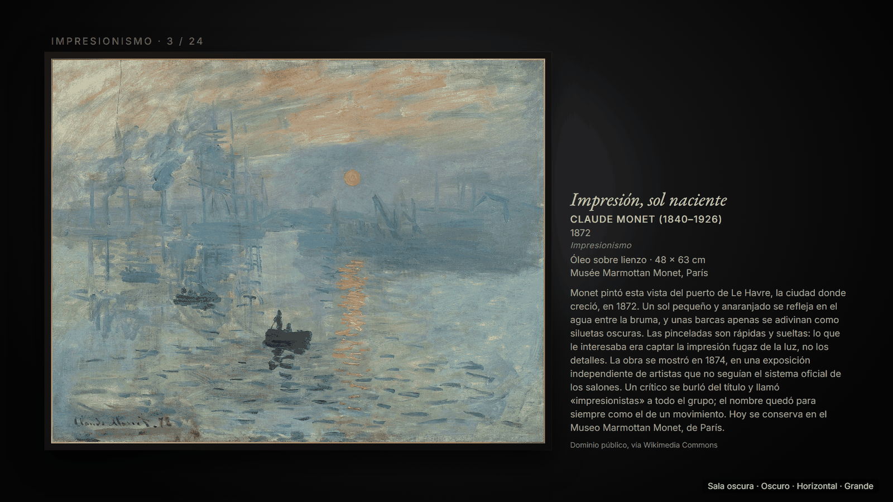
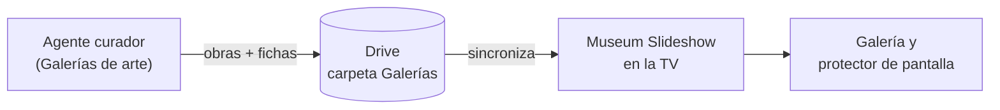

<p align="center"></p>

# Museum Slideshow

Una galería de arte para la tele. Es una app de Android TV que se maneja con el control y que, a la vez, es el **protector de pantalla**: cada obra se muestra colgada como un cuadro de museo, con su marco, su cartel y su explicación, para mirar y para aprender.

Hecha a medida para una TCL Google TV. Las obras vienen de una carpeta pública de Google Drive.

## Cómo se ve

> Son los **diseños aprobados** (borradores en [`docs/diseno/`](docs/diseno/)), no capturas de la tele.

**Inicio**



**Galerías**



**Un tema: Sala oscura**



## Qué hace

- **4K real**: la obra se dibuja a 3840×2160, aunque el resto de la interfaz sea 1080.
- **Cuatro temas** (Galería moderna, Sala oscura, Inmersivo, Libro de arte) y **modos** Claro, Oscuro o Automático (claro de día, oscuro de noche), con varios colores de pared.
- **Marcos**: uno por tema, fijo, al azar o el que diga la galería (por ahora un negro fino; vienen fotos de marcos reales).
- **Pared de verticales**: 2 o 3 obras verticales colgadas juntas, cada una con su nombre.
- **El cartel se acomoda solo**: va donde hay lugar, nunca tapa la obra y nunca corta un texto.
- **Protector con "Volver al anterior"**: un botón lo activa y otro deja todo como estaba.
- **Reserva de obras sin internet**: guarda un grupo de obras en la tele para que ande aunque se caiga la conexión.
- **Copia 4K de Drive**: baja cada obra en su versión 4K y usa el original solo de respaldo.
- Todo lo que puede ser opción es un ajuste, con su valor por defecto.

## Cómo funciona



El curador arma las galerías (imágenes y `galeria.json` con la ficha de cada obra) y las deja en la carpeta "Galerías" de Drive. La app las baja, guarda una copia lista para la pantalla y las muestra. Sin librerías de terceros: solo Kotlin, Jetpack Compose for TV y AndroidX.

## Para trabajar en el repo

Se trabaja con Claude Code, con un chat nuevo por misión:

- `/inicio` — arranca la sesión y retoma donde quedamos.
- `/cierre` — deja los documentos al día, hace el commit y el push.
- `/instalar` — compila, instala en la TV y verifica que abre.

Para compilar y correr las pruebas (en PowerShell, con el JDK 17):

```powershell
.\gradlew.bat assembleRelease testDebugUnitTest
```

Los detalles del entorno están en [`docs/desarrollo.md`](docs/desarrollo.md).

## Mapa de documentos

| Archivo | Para qué |
|---|---|
| [`SPEC-0.md`](SPEC-0.md) | El diseño completo de la app |
| [`docs/SESSION_HANDOFF.md`](docs/SESSION_HANDOFF.md) | Dónde quedamos en la última sesión |
| [`docs/TODO.md`](docs/TODO.md) | Lo que falta hacer |
| [`docs/CHANGELOG.md`](docs/CHANGELOG.md) | Historia de cambios |
| [`docs/diseno/`](docs/diseno/) | Diseño visual aprobado y sus decisiones |
| [`docs/formato-galeria.md`](docs/formato-galeria.md) | Formato de `galeria.json`, para quien arma las galerías |
| [`docs/curaduria.md`](docs/curaduria.md) | Cómo se trabaja con el agente curador: quién hace qué y cómo pedirle |
| [`docs/desarrollo.md`](docs/desarrollo.md) | Entorno, compilar e instalar |

## Proyectos hermanos

- **Volumen Maestro** (`../volumen-maestro`): la app que maneja el volumen de la misma tele; ahí vive la historia de la TV.
- **Galerías de arte** (`../galerias-de-arte`): la biblioteca curada de obras y fichas que alimenta a esta app.
